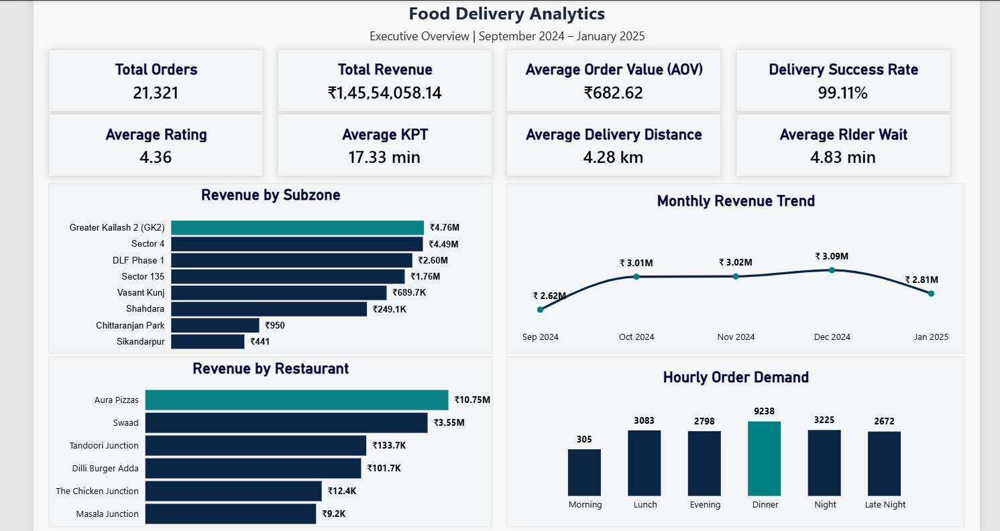
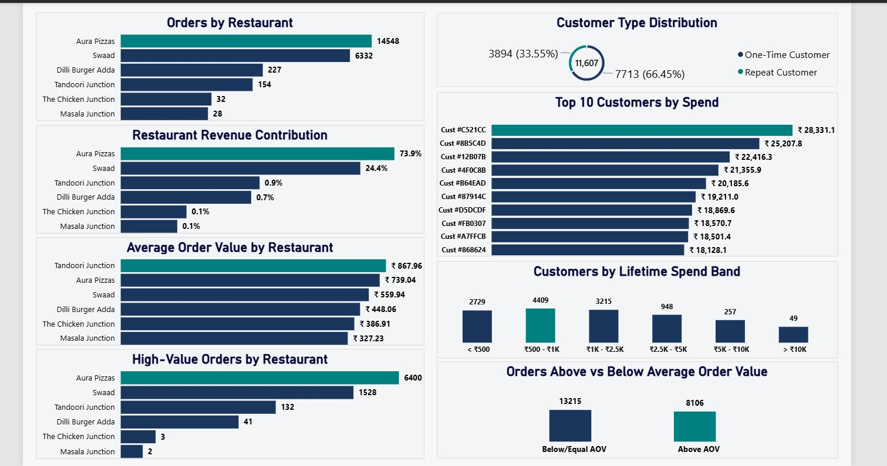
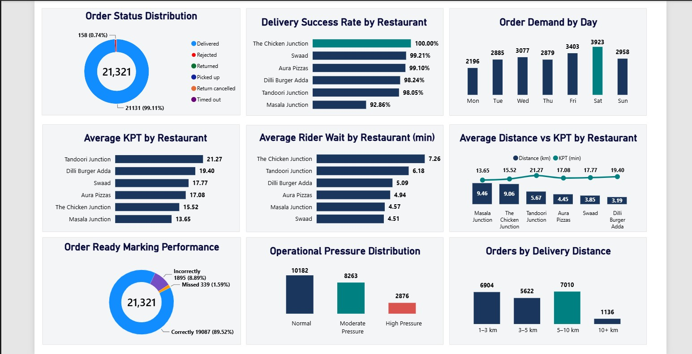
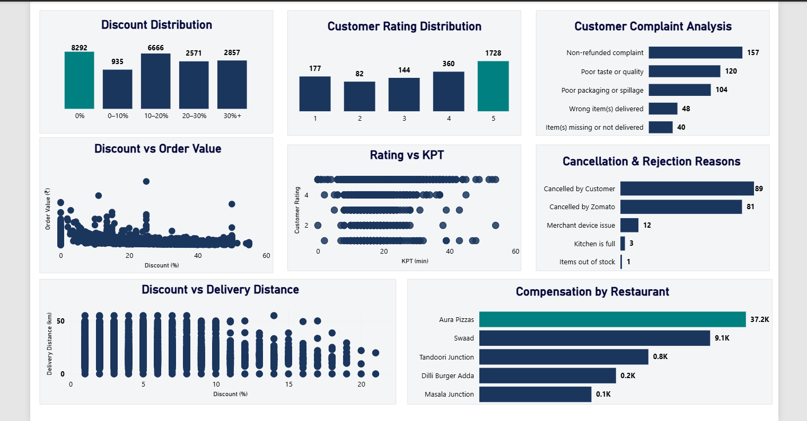

# 🛵 Food Delivery Analytics — End-to-End Power BI Project

An end-to-end analytics project where I analyzed **21,321 food delivery orders** (Sep 2024 – Jan 2025). The goal was to understand delivery bottlenecks, kitchen prep performance, customer retention patterns, and subzone revenue trends.

---

## 🛠️ Tech Stack & Workflow
* **MySQL:** Stored the dataset, wrote verification queries, and handled NULL values / edge cases.
* **Power BI & DAX:** Built the data model, custom calculated columns, and sorting logic for operational buckets.
* **Excel / CSV:** Initial inspection and sanity checks on order attributes.

---

## 📊 Dashboard Breakdown

### Page 1: Executive Overview
* High-level health check: **₹1.45 Cr Revenue**, **21,321 Orders**, **₹682.62 AOV**, and a **99.11% Delivery Success Rate**.
* Tracks monthly revenue trends, top subzones (Greater Kailash 2 & Sector 4), and hourly spikes (Dinner peak driving 9.2K orders).



---

### Page 2: Restaurant & Customer Analytics
* Identified a heavy Pareto split: Just two outlets (*Aura Pizzas* and *Swaad*) drive over **98%** of the gross revenue.
* Segmented customers into One-Time (33.5%) vs Repeat (66.5%) and mapped them across lifetime spending tiers.



---

### Page 3: Delivery & Operations
* Mapped Kitchen Preparation Time (KPT) against delivery distance to spot restaurant-level operational lag.
* Analyzed "Order Ready" marking compliance (~89.5% accuracy) and bucketed distance into clean intervals (`1–3 km`, `3–5 km`, `5–10 km`, and `10+ km`).



---

### Page 4: Discounts & Customer Experience
* Evaluated discount depth vs order value and checked how cancellations split between customer-initiated and platform-side issues.
* Monitored customer feedback, top complaint categories, and merchant compensation payouts.



---

## 💡 Practical Takeaways
1. **Dinner Peak Dispatch:** 43% of orders happen during the dinner rush, meaning rider supply needs tighter scheduling during this window.
2. **Kitchen Delay Alerts:** Restaurants crossing 20+ mins average prep time directly inflate rider wait times, pointing to a need for real-time prep alerts.
3. **Retention Focus:** With repeat customers driving two-thirds of the platform's volume, loyalty incentives make more financial sense than aggressive cold discounts.

---

## 📂 Project Structure
```text
├── assets/      # Exported visuals and page screenshots
├── powerbi/     # Final .pbix file and report PDF
├── sql/         # Schema and business verification queries
└── README.md    # Project summary